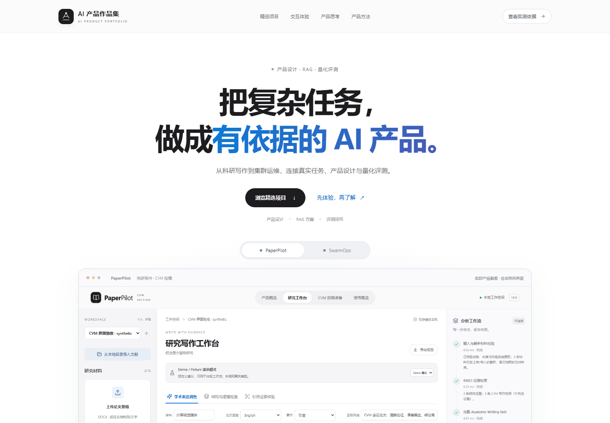

# AI 产品作品集

**[打开交互作品集 →](https://2249921267.github.io/workDemo/)**

[](https://2249921267.github.io/workDemo/)

围绕 **PaperPilot** 与 **SwarmOps**，展示从场景拆解、产品流程到 RAG 方案、Workflow 编排和量化验证的个人产品实践。工程实现借助 AI 编码工具完成。

## 精选项目

| 项目 | 产品问题与方案 | 可追溯的量化结果 |
| --- | --- | --- |
| [PaperPilot · CVM Edition](https://2249921267.github.io/workDemo/paperpilot.html) | 面向 CVM 投稿，把研究证据与写作范例分开，保留原页溯源与人工审阅 | 23 篇 / 470 页 / 2,076 正文块；46 条自建主题定位开发题命中 46/46；80 条合成预检 F1 0.988 |
| [SwarmOps · 集群运维](https://2249921267.github.io/workDemo/swarmops.html) | 告警状态、混合检索、Dify 三分支诊断与人工反馈 | 36 份原创教学 SOP / 213 片段；108 条范围内冻结测试，默认 RRF Recall@5 80.6%、误拒答 10.2%；SSE 修复后 351 项本地回归通过 |

**[指标口径与公开快照](https://2249921267.github.io/workDemo/evidence.html)**：逐项记录样本、分母、执行条件和版本，支持查阅与复现。

## 可以体验什么

- 写作审阅：结论范围、数字保护、来源不足，以及采纳和撤销。
- 告警处置：离线抑制重复告警、确认接手与指标恢复的区别、正常/无效输入绕过模型。
- 检索策略：切换四种冻结策略，查看同一真实评测样例的排名回放。
- Dify 原图：打开用户提供的完整流程，缩放并检查三分支与报告出口。
- 桌面与手机：打开即可体验，交互在浏览器内完成。

演示采用预设合成样例和冻结结果回放。公开内容包括案例、项目截图与筛选后的指标快照。

## 本地运行与检查

静态站点在 `site/`，原生 HTML/CSS/JavaScript，无运行时框架或外部字体依赖。

```sh
npm ci
npm run dev
# http://127.0.0.1:4173/workDemo/
npm run check
npm test
```

本机浏览器检查默认 Edge；其他环境可设置 `PLAYWRIGHT_CHANNEL=chromium`，先运行 `npx playwright install chromium`。
GitHub Actions 在检查通过后发布到 GitHub Pages，发布目录仅为 `site/`。

## 来源与版本

- PaperPilot：v3.0.0，2026-10-28 的固定评测与工程验收。
- SwarmOps：v2.0.0 冻结批量评测，另列后续 SSE/Live v2 联调记录，2026-10-28。
- Dify 全流程 PNG：用户提供，原图复制，未据画布配置名推断解析模型版本。
- [公开指标 JSON](site/assets/metrics.json) · [图片指纹](site/assets/asset-manifest.json) · [展示与维护说明](docs/PORTFOLIO_NOTES.md)

本作品集公开展示日期为 2026-10-29。后续验证将围绕独立用户任务、语义质量和实际操作耗时展开。
